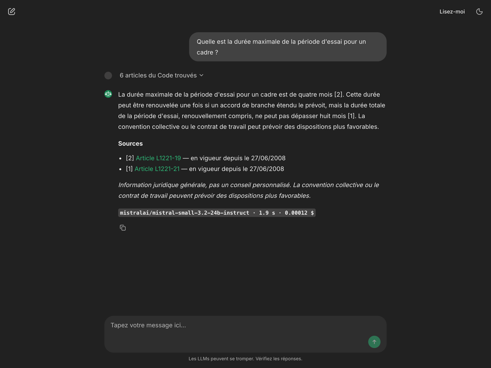

<picture>
  <source media="(prefers-color-scheme: dark)" srcset="assets/header-dark.svg">
  
</picture>

<p align="center">
  <a href="https://www.linkedin.com/in/‹à-compléter›"></a>
  <a href="mailto:salmane.maazouzi@gmail.com"></a>
  
  
</p>

Ingénieur IA & Data diplômé de l'**INSA Rouen Normandie**, je construis des applications d'IA générative **qui citent leurs sources, se testent et se mesurent** : RAG, systèmes multi-agents, évaluation et mise en production.
Ce qui me motive : faire passer un LLM du prototype qui impressionne en démo au système fiable sur lequel une équipe peut compter.

> [!TIP]
> **🟢 En recherche active : poste d'ingénieur IA générative / LLM Engineer** (‹CDI›) · ‹Paris / Lyon / télétravail› · disponible ‹immédiatement›
>
> RAG, agents, évaluation de LLM, LLMOps. Parlons-en : [salmane.maazouzi@gmail.com](mailto:salmane.maazouzi@gmail.com) · [LinkedIn](https://www.linkedin.com/in/‹à-compléter›)

## 🤖 `.well-known/agent-card.json`

Mes agents se présentent entre eux avec une *Agent Card* (protocole [A2A](https://a2a-protocol.org)). Voici la mienne :

```jsonc
{
  "name": "Salmane El Maazouzi",
  "description": "GenAI engineer: turns LLM prototypes into reliable, measurable systems.",
  "skills": [
    { "id": "rag",    "tags": ["retrieval", "pgvector", "reranking", "citation checks"] },
    { "id": "agents", "tags": ["LangGraph", "A2A", "tool calling", "human-in-the-loop"] },
    { "id": "llmops", "tags": ["evaluation", "cost & latency tracking", "CI", "typed Python"] },
    { "id": "deep-learning", "tags": ["PyTorch", "GANs", "CNN architectures", "HPC / Slurm"] }
  ],
  "languages": ["fr", "en"],
  "status": "open_to_work"   // ← voir ci-dessus 👆
}
```

## 🚧 En cours

<table>
<tr>
<td width="50%" valign="top">

### ⚖️ [DroitClair](https://github.com/selmaazouzi/droitclair-rag-travail)

**Assistant RAG sur le droit du travail français** : il répond uniquement à partir du Code du travail officiel et cite chaque article utilisé.

- 686 articles récupérés via l'**API Légifrance**, ingestion idempotente
- **bge-m3** + **pgvector** (HNSW), LLM interchangeable (OpenRouter ou Ollama en local)
- **Vérification automatique des citations**, réponses en streaming (FastAPI + SSE, Chainlit)
- 162 tests, `mypy --strict`, CI sur une vraie base pgvector
- **Prochaine étape :** recherche hybride, reranking et évaluation chiffrée

`Python` `FastAPI` `PostgreSQL` `pgvector` `OpenRouter` `Ollama`

</td>
<td width="50%" valign="top">



</td>
</tr>
<tr>
<td width="50%" valign="top">

### 🛒 [Assistant d'achat multi-agents](https://github.com/achrafElFaiq/multi-agent-shopping-assistant)

**Trois agents LangGraph qui dialoguent via A2A** pour comprendre une demande, chercher dans le catalogue Shopify et acheter après validation humaine.

`LangGraph` `A2A` `PostgreSQL` `pgvector` `RAG`

</td>
<td width="50%" valign="top">

**Ma contribution** (contributeur principal, projet à 3) :
- l'agent **préférences utilisateur** (outils, appel de fonction, persistance PostgreSQL)
- la **pause d'approbation humaine** avant paiement
- le graphe LangGraph initial, les schémas Pydantic et la CI

</td>
</tr>
</table>

## 🗂️ Projets précédents

| Projet | Ce que j'ai fait | Stack |
|---|---|---|
| **RegNet** · reproduction de *Designing Network Design Spaces* (FAIR) | Implémentation de RegNetX et entraînement sur ImageNet, sur un cluster de calcul | PyTorch, Slurm |
| **EdgeConnect** · reconstruction d'images | Entraînement d'un GAN en deux étapes (contours, puis texture), comparaison de méthodes d'extraction de contours, évaluation PSNR / SSIM / FID sur CelebA | PyTorch, MLflow |
| **Générateur d'examens** | API qui compose des examens à partir d'une banque de questions, avec génération de questions par RAG | Flask, LangChain, FAISS, Ollama |
| **Robot autonome** | Suivi de ligne, détection d'obstacles, pilotage à la manette, sur Raspberry Pi | C, Raspberry Pi, I²C |
| **Compression de Huffman** | Compresseur et décompresseur de fichiers, avec tests unitaires | C |

## 🧭 Parcours

| | |
|---|---|
| **‹année›** | 🎓 **Diplôme d'ingénieur IA & Data**, INSA Rouen Normandie |
| **‹dates›** | 💼 **‹Poste›**, ‹Entreprise› · ‹une ligne sur ce que tu as livré› |
| **‹dates›** | 💼 **‹Poste›**, ‹Entreprise› · ‹une ligne sur ce que tu as livré› |

## 🧰 Outils

| | |
|---|---|
| **IA générative** |        |
| **Recherche & ML** |       |
| **Back-end & données** |       |
| **Ingénierie** |         |
| **Aussi** |     |

---

<p align="center"><sub>Un projet d'IA générative à fiabiliser ? <a href="mailto:salmane.maazouzi@gmail.com">Écrivez-moi</a>.</sub></p>
